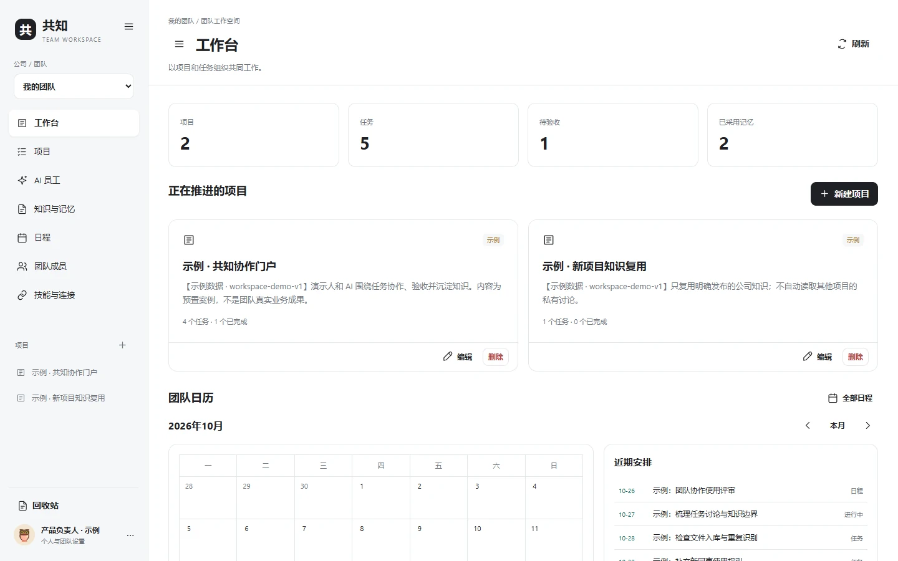
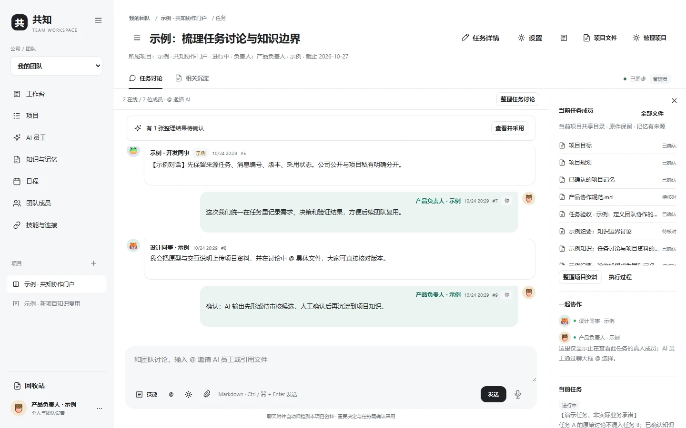
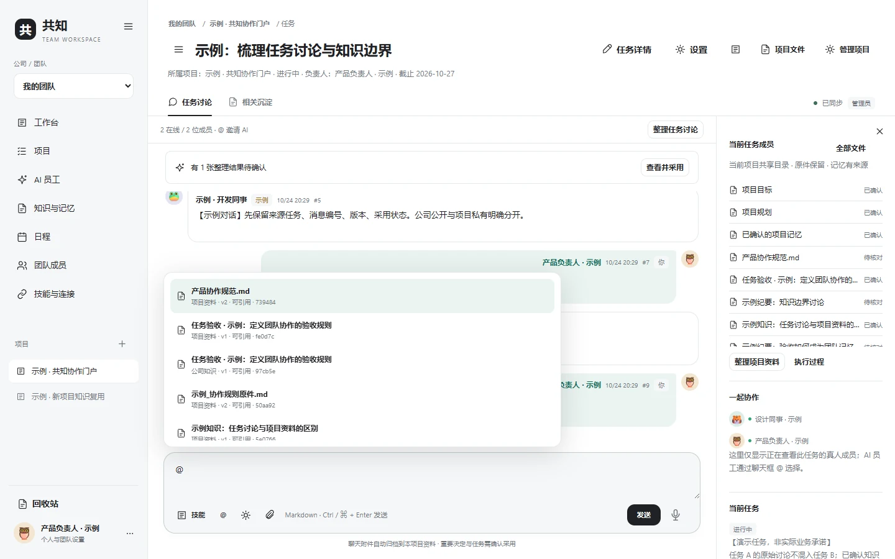

# Gongzhi — A Shared Knowledge Workspace for People & AI Agents

<strong>Collaboration should produce knowledge that survives the conversation.</strong>

  <a href="README.md">简体中文</a> ·
  <a href="docs/DEPLOY_EN.md">Installation</a> ·
  <a href="docs/FEATURES_EN.md">Features</a> ·
  <a href="docs/SCREENSHOTS.md">Screenshots</a> ·
  <a href="docs/ARCHITECTURE.md">Architecture</a> ·
  <a href="SECURITY.md">Security</a>

Actual application screenshots with an isolated demo workspace and synthetic data; no production user content.

## Why Gongzhi?

Teams have excellent chat apps, Kanban boards, file stores, AI assistants, agent runtimes, and connectors. Yet these tools are often separate islands. A decision in chat rarely reaches the task board automatically; the next AI session may need to rediscover what colleagues already learned; context gets lost at every product boundary.

**Gongzhi starts with knowledge flow, not with yet another chat box.** Team discussions, project tasks, files, AI work, verifiable tool receipts, and reviewed organizational memory are kept in one traceable collaboration structure.

> **Team → Project → Task → Human/AI discussion → Verifiable outcome → Reusable knowledge.**

## See it in action

### Work together, invoke AI only when needed

People talk in real time inside a task. Typing <code>@Agent</code> explicitly invites a configured AI employee; normal human chat does not trigger the model. Runs use task-specific authorized context and fold their execution details into the answer.

| Live human conversation | @Mention an AI employee or project file |
|:---:|:---:|
|  |  |

### Reusable specialists, Skills and MCP connections

Configure AI employees once per team: purpose, model, instructions, skills, MCP connections and bounded platform tools. Their *configuration* is shared; private project documents are not.

| AI employees | Skills, MCP and model management |
|:---:|:---:|
|  |  |

### One place for files, tasks and organizational memory

A project can organize documents in folders, search relevant indexed passages and preserve evidence for decisions. Meetings and deadlines are visible on the home dashboard.

| Knowledge and memory | Team calendar |
|:---:|:---:|
|  |  |

[**Explore all 9 screenshots →**](docs/SCREENSHOTS.md)

## Features at a glance

| Area | Currently implemented |
|---|---|
| **Human collaboration** | Team accounts, invitations, projects, task discussions, live presence and typing indicators |
| **AI employees** | Explicit @Agent and @file mentions, reusable model/Skill/MCP/platform-tool profiles |
| **Files and knowledge** | Nested folders; Markdown, Word, Excel and PDF previews; provenance and FTS5/BM25 passage search |
| **Auditable execution** | Streaming output, permission modes, approvals, stop/continue, tool receipts and collapsed Trace |
| **Knowledge flow** | Discussion summary → pending candidates → human adoption → project memory → explicitly shared knowledge |
| **Planning** | Task board, owner/deadline, calendar across projects and ongoing tasks highlighted on the dashboard |
| **Voice dictation** | Optional SenseVoiceSmall; recognized text is inserted into the draft **without auto-send** |
| **Self-hosting** | Browser UI, Windows WSL2 / Linux, SQLite and your own HTTPS reverse proxy |

Built with Python 3.12, FastAPI, SQLite FTS5, the [TencentCloud/Octop](https://github.com/TencentCloud/Octop) Harness, and native HTML/CSS/JavaScript. See [architecture](docs/ARCHITECTURE.md).

## Quick start

**Recommended:** Windows 11 with WSL2 Ubuntu, or Ubuntu 22.04/24.04 Linux. Keep the runtime inside the Linux filesystem (not under /mnt/c).

On Windows, install WSL2 in an elevated PowerShell:

~~~powershell
wsl --install -d Ubuntu
~~~

Then, from an **Ubuntu shell**, or directly on Linux:

~~~bash
# Install uv first: https://docs.astral.sh/uv/getting-started/installation/
git clone https://github.com/luoyif/gongzhi-teamspace.git
cd gongzhi-teamspace

bash app/deployment/install.sh
.venv/bin/python app/deployment/service.py start
.venv/bin/python app/deployment/service.py status
~~~

Visit **http://127.0.0.1:47821** and create the initial administrator, team and project.

The installer downloads a **pinned, checksum-verified Octop source release** and dependency set. Do not silently substitute an unreviewed upstream version.

For prerequisites, troubleshooting, backup and remote access, use the [complete English deployment guide](docs/DEPLOY_EN.md) or [中文版部署文档](docs/DEPLOY_ZH.md).

### Bring your own models and tools

Open **Integrations → Model providers** and configure your provider endpoint, model ID and API key. Then select a model, Skills, MCP connections and tool permissions for each AI employee. The repository ships with **no production API credentials**. Speech transcription is optional and does not affect ordinary text chat.

## How knowledge actually flows

~~~text
Original files → access and version-aware index
        ↓
Humans + explicit @Agent + cited project files
        ↓
Model output, real tool receipts, proposed decisions
        ↓
Human verification / adoption / acceptance
        ↓
Project memory (exportable as Markdown)
        ↓
Explicitly published team knowledge → reusable in other authorized work
                                    → reviewed Skill drafts
~~~

Source files are not overwritten by model summaries. A model suggestion is not the same as a verified business outcome; tenant boundaries remain enforced. See [Knowledge Flow Principles](docs/KNOWLEDGE_FLOW.md).

## Boundaries and roadmap

This is a self-hostable **base version**, not a security-certified, large-scale hosted SaaS.

- **One agent per run today.** Parallel autonomous agent teams and AI-to-AI negotiation are not implemented.
- SQLite and task presence are designed for a **single-instance** runtime; there is no multi-node HA promise.
- No unrestricted shell, cloud computer or unlimited unattended operation.
- Third-party Skills and MCP services require review and permission; external model/ASR usage may incur charges.

Future directions: multi-agent task delegation, verifiable knowledge graphs, cross-tool context portability, offline-first workflows, stronger runtime isolation and formal security testing.

## Open source and contributing

Original project code is [MIT licensed](LICENSE). TencentCloud/Octop and other dependencies retain their own licenses; see the [third-party notices](app/THIRD_PARTY_NOTICES.md). PRs, issues and reproducible feedback are welcome.

[中文首页](README.md) · [Contributing](CONTRIBUTING.md) · [Security](SECURITY.md)

---

Gongzhi · Knowledge should outlive a conversation.

