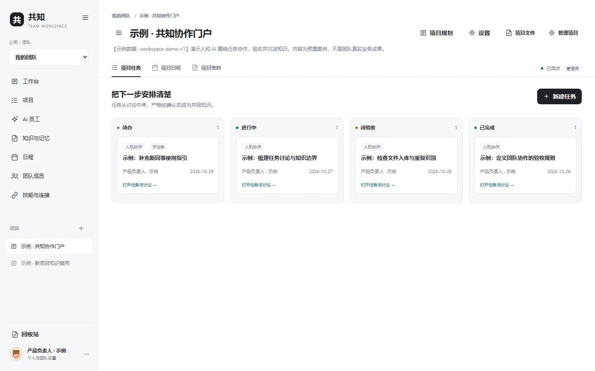
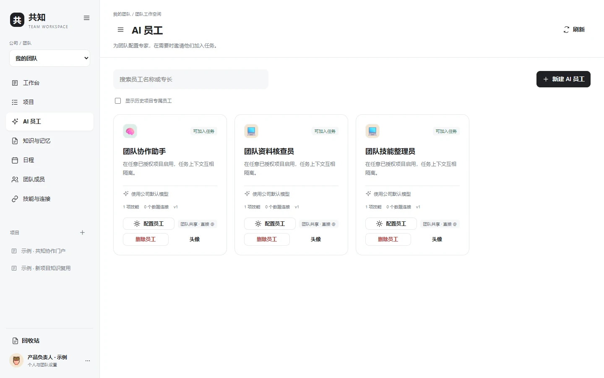
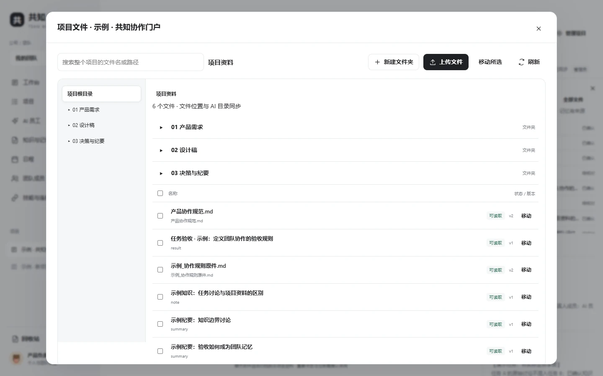
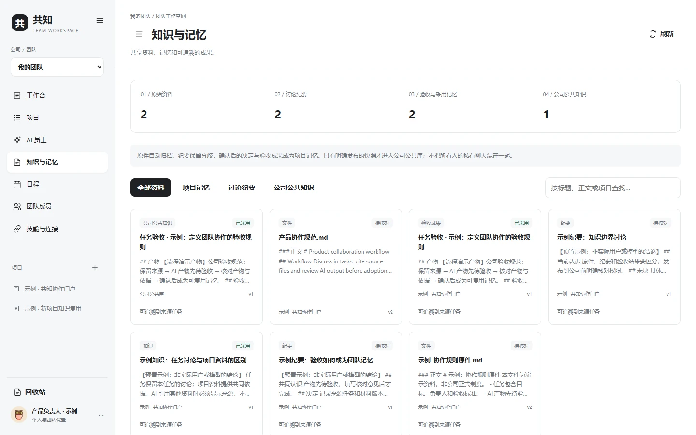
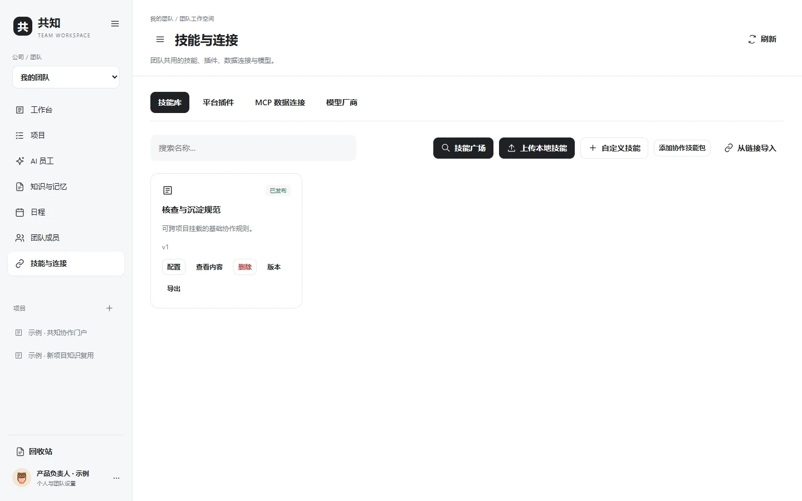
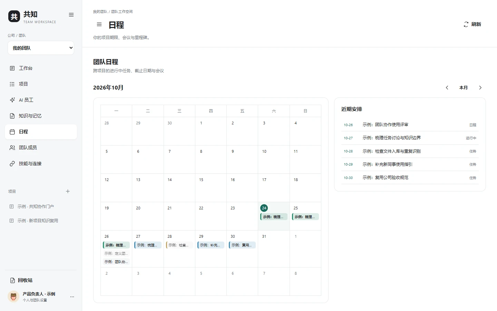

# Gongzhi — Feature Guide (English)

[English README](../README.en.md) · [中文版](FEATURES_ZH.md) · [Screenshot gallery](SCREENSHOTS.md) · [Deployment](DEPLOY_EN.md)

Gongzhi is not simply a chat app with an AI button. Its foundation is **knowledge flow**: conversations, evidence, actions and reviewed decisions should become traceable assets shared by a team, rather than isolated snapshots scattered across apps.

## 1. Team → Project → Task → Conversation

A **team** owns members, projects, reusable AI employee profiles and reviewed common knowledge. A **project** owns a plan, calendar, folder tree and tasks. A **task** owns its multi-person discussion, file references, AI runs, approvals and outcomes.

- Admins manage projects and tasks with scoped access, status, owners, deadlines and review requirements.
- Two or more authenticated humans can converse in the same task, with live presence and typing notifications.
- Human and AI messages are visually distinguished. Your own human messages are aligned to the right.
- Normal human conversation does not automatically call any model. An explicit @Agent invocation is required.

## 2. AI employees as reusable capabilities

Configure AI specialists once at team level: name, role, system instructions, SOUL.md / AGENTS.md, model, Skills, MCP servers, platform tools and execution budget. They can be used in authorized projects without duplicating employee configurations or leaking private data across projects.

During a run, approvals, tool receipts, streamed responses, model steps and known token usage are accessible in collapsible Trace. No private chain of thought is synthesized or falsely displayed as a tool log.

The optional elevated approval mode **does not grant unrestricted host machine access**; project ACL, allowlisted tools and execution limits still apply.

## 3. Project folders and source-aware retrieval

Nested folders, upload, renaming, moving, filename/path lookup, preview and version-aware references live inside the project. Common Markdown, JSON, text, Word, Excel, PDF and image formats can be previewed where supported. Scanned PDFs without a text layer should not be treated as already parsed evidence.

Agents can first search the index or list a project directory, then fetch relevant passages or sections on demand. Current retrieval uses **SQLite FTS5/BM25 chunk search**, not a marketed-as-complete vector knowledge graph.

## 4. From discussion to trusted organizational memory

The intended lifecycle is **original material → scoped discussion → proposed minutes or actions → human review → adopted project knowledge → explicitly published team snapshot**.

- Original content and model summaries are separate, with provenance and versions.
- A model suggestion does not silently become a verified fact or team policy.
- Team-shared knowledge requires publication, which can later be revoked.
- Approved experience can produce a Skill draft, which is reviewed independently before use.

The goal is not to claim that a model remembers everything; it is to build a memory and knowledge system people can inspect and maintain.

## 5. Skills vs MCP vs internal platform plugins

| Component | Responsibility |
|---|---|
| **Skill** | Describes a method, procedure or output contract via SKILL.md and supporting files |
| **MCP** | Connects to approved external services and databases; tools require live validation and scoping |
| **Platform plugin** | Performs approved internal actions on tasks, calendars, knowledge, files and plans |
| **Harness** | Controls model/tool loops, timeouts, run budgets, context and approvals |
| **Model provider** | Lets an administrator configure supported API protocols, endpoints, model IDs and private credentials |

External Skill packages are imported as inactive reviewable drafts, not executed on import. An unconfigured MCP server is never silently treated as an authorized connection.

## 6. Dashboard and calendars

A task marked **in progress** remains highlighted from the current date through its due date (inclusive). An overdue task is not painted as continuously active on every later day; its deadline and overdue notice remain available. Completed, cancelled and paused work is distinguished from ongoing work. Multi-day events display across their start-to-end date range.

The home dashboard includes the same calendar logic, making upcoming work visible without switching to a separate planner. Date-only task logic respects the project timezone.

## 7. Speech transcription as assisted typing

A small outlined microphone appears in chat and longer text fields. Record, stop, receive a transcript via the optional SenseVoiceSmall provider, and **review the resulting draft**. Transcription never clicks Send, starts an agent, creates an event or stores the audio in project knowledge.

Microphone capture requires a secure browser context and user permission. The speech provider may impose charges, latency and rate limits.

## 8. What is not yet implemented

This is a real self-hostable single-instance base, not a completed enterprise SaaS or distributed multi-agent operating system.

**Planned but not shipped:** parallel autonomous multi-agent orchestration, AI-to-AI negotiation within a single turn, arbitrary host shell access, independent cloud computers, multi-node high availability, and a fully verifiable cross-service knowledge graph.

## 9. Who should try it?

Product, research, design, engineering and learning-content teams that want one workspace for collaborative discussion, project files and scoped AI assistance—and prefer self-hosted infrastructure, explicit authority and traceable outcomes.

[Installation](DEPLOY_EN.md) · [Architecture](ARCHITECTURE.md) · [Knowledge flow](KNOWLEDGE_FLOW.md)
