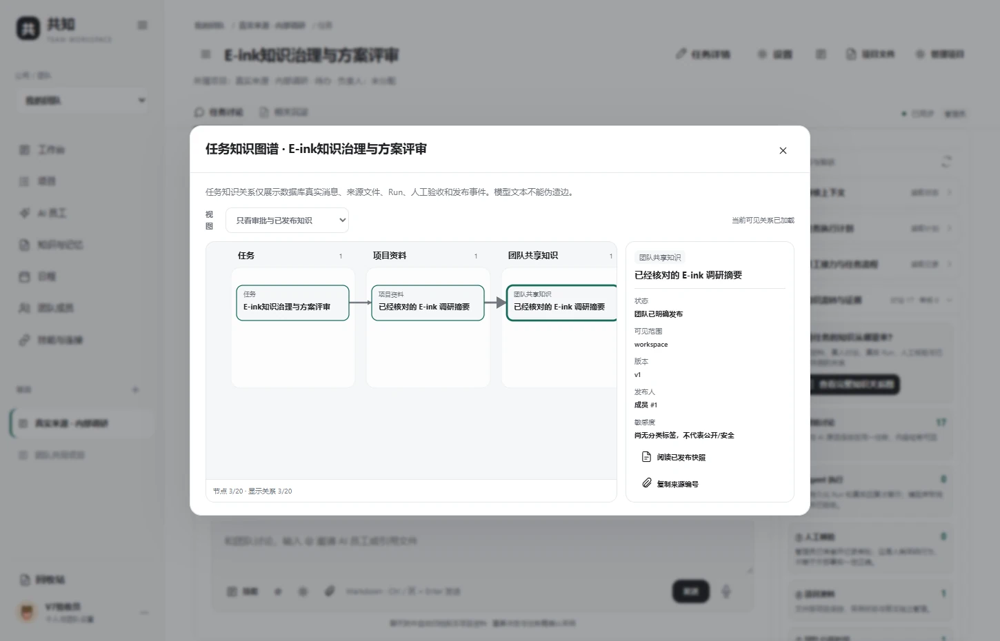
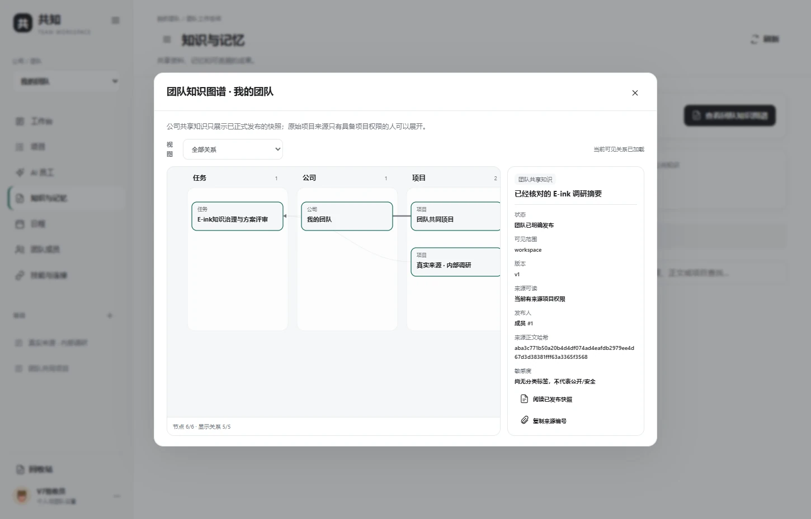
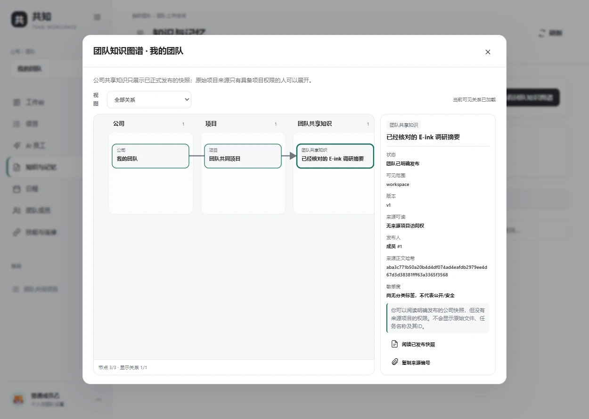
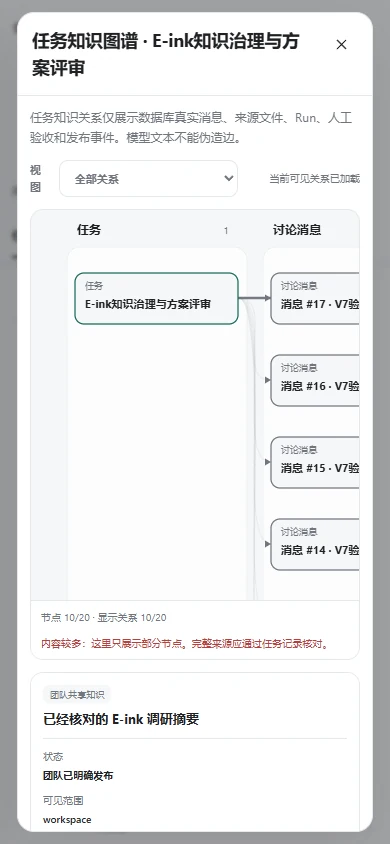

# 共知知识流转图谱：任务、来源、人工核验与组织发布

[中文首页](../README.md) · [English](KNOWLEDGE_GRAPH_EN.md) · [三方对比](WHY_GONGZHI_ZH.md) · [测试矩阵](TEST_MATRIX_ZH.md)

> 核心原则：**图谱应帮助团队判断“这条知识能否被信任和复用”，而不是因为两个词相似就让 AI 画出没有依据的关系。**

## 1. 一张图解决什么问题？

共知现在有两种互补的关系图：

**任务知识图谱**：在项目的某一个任务中，从真人讨论到 AI 执行、原始上传、Tool Trace、人工验收、已采用项目资料与最终已发布公司快照，按照数据库中的真实来源 ID 连接。你可以点击节点查看来源编号、版本、哈希、审批状态，并回到对应任务、资料或 Run。

**公司共享知识图谱**：从“知识与记忆”进入，查看这个团队实际发布了哪些知识快照、与哪些项目有关。关键在于**权限分层**：不属于原项目的公司成员可以读明确发布的公共快照，但不能因为读到它便获得私人项目的资料、任务名、源 ID 或原始文件内容。加入原项目后才能查看相应来源；移除权限后再次请求立即隐藏。

这正是我们与“单纯多Agent群聊”的产品取舍：所有知识先有**任务归属**，由人决定何时将结果从讨论/候选晋升成可被团队使用的知识。

## 2. 工作台使用方式

1. 进入公司 → 项目 → 任务 → **任务讨论**。平时依旧用真人聊天、`@AI员工` 和 `@文件`；不会因为打开图谱就调用模型。
2. 在右侧折叠栏展开 **「知识流转与证据」**。先看到来源与状态数量、真实来源节点列表；折叠时没有额外图谱网络请求。
3. 点击 **「查看完整知识关系图」**。可在图谱中选择“全部关系 / 只看来源与执行 / 只看审核与已发布知识”，点击节点检查详情。
4. 在公司一级 **「知识与记忆」**页面点击 **「查看团队知识图谱」**。跨项目阅读已发布快照，但不暗中读取其他项目的未共享原文。
5. 手机端同样能打开，复杂图以容器内横向滚动，整页不横向溢出。大量消息的图只展示最近/部分节点，会明确标注“部分”，完整记录仍可在任务历史回查。

### 任务证据关系：浏览器实际截图

### 团队共享知识图谱

### 同公司但没有原项目权限时

### 手机端

## 3. 六类真实来源关系

| 来源 / 状态 | 系统依据 | 图里可以做什么 | 明确不能推导什么 |
|---|---|---|---|
| 真人讨论 | `team_messages` 的 ID、seq、发言人、正文 SHA-256、task_id | 定位谁说过什么、识别后来的更正 | **没有**自动变成已确认事实 |
| Agent Run | `team_runs` 与 `team_run_events` | 核对启动、完成、工具事件（不展示私有思维） | Run 完成不等于业务外部效果正确 |
| 原始文件 | `team_uploads`、`team_objects`、来源消息和版本 | 找到文件的上传出处与资料版本 | 文件名和内容不因此变成公共资料 |
| 人工审核 | 流程步骤 `approved_by`、`status`、审核备注的 SHA | 知道真人是否确认某步，哪些还等待核验 | 人工批准不等于形式化证明 |
| 项目采用 | 项目文档 `adopted` 且 `status=ready` | 区分候选与项目确认的版本 | 项目采用**不**自动公开给全公司 |
| 公司发布 | `team_public_knowledge` 的 published/withdrawn/superseded 快照 | 查看真实已发布资料、撤回后立即移出索引 | 发布快照**不**自动授予来源项目权限 |

图谱的线来自存储的引用关系（例如消息产生 Run、Run产生AI回复、文件来自某次上传、通过人类审核的步骤、来源文件被正式发布为快照）。**不会让 LLM 根据文字相似度凭空认定因果关系或未经授权推测内部成员。**

## 4. 权限、安全与性能边界

- 任务接口每次检查 **项目 + 任务当前访问权**，公司接口每次检查**公司成员身份**；公司源节点还要单独检查原项目成员身份。公司级通用 Agent 配置不能越权。
- 未授权时，公司图不返回原项目ID、源任务标题、源文件ID/正文，只有经过授权发布的公司快照标题可以看到；这是已经公开给团队的内容。
- 接口不返回讨论正文、模型完整请求、工具返回正文或 API 密钥；只返回必要元数据与哈希。实际打开文件或 Run 仍使用原平台的权限 API。
- **敏感度自动分类、精确的信息流证明尚未实现。** 节点会明确标为“未分类”，绝不能把“未标为敏感”等同于“已证明安全”。QM 在来源敏感度和披露控制方面仍有值得进一步借鉴的能力。
- 查询以任务／公司为范围并有硬数量上限（如最近90条任务消息、最多24个 Run、最多30份资料、公司最多100份快照）。超限显示 partial，不冒充“已经看完全部历史”。
- 前端 SVG 在浏览器渲染，不调用付费 LLM，不向外部图谱服务传输数据。用户展开才查询，避免普通聊天长久等待。
- 当前提供的是**来源/执行证据图谱（Provenance Graph）**，还不是实体抽取、概念关系推理或跨全公司的语义知识图谱。后者若加入，必须把 AI 推测关系与真实引用关系明显区分。

## 5. 三方取长补短，不能夸大独创性

- **QM（MIT）** 的 Scope 隔离、敏感度和来源标签、版本化记忆、授权再检是成熟技术参考。共知本次先做**任务/公司两级可见性的来源图**，但尚未实现 QM 那样全面的敏感度分类、持久独立计算机和跨云权限体系。
- **Ekko Studio（BSL 1.1）** 的 Agent可视化、上下文摘要、任务运行与工作流体验值得参考。共知保留“所有对话依附任务”的信息架构，图谱与现有审批卡、Trace 共处，不复制 Ekko 限制许可证的组件。
- **共知的差异**不在“别人没有记忆”，而在让团队默认用 **任务→可核验执行→人确认→项目采用→公司发布/撤回** 的业务纪律工作，减少碎片化聊天和结果无法回用。

## 6. 真实测试（跨环境与边界）

- 新原生 WSL 后端单元测试覆盖跨任务/撤权、上传/Trace来源、审核与发布不同状态、长历史截断、公司快照撤回。
- 新 WSL HTTP 测试用隔离 FastAPI+Octop服务及两位合成成员核验公司发布、项目 ACL、权限撤销和撤回。
- 新 Windows Chrome 检查图谱弹窗、节点点击、关系筛选、公司图两类受众与移动端。不涉及正式账号、真实业务文件或收费模型。
- 全量历史 Python/HTTP、前端 Node 回归必须以当前版本的发布清单为准；不能用上轮通过结果冒充本轮。

## 7. 接下来还需继续强化

**治理优先：**可配置敏感度／受众策略与来源撤销影响分析；**知识优先：**经人工校验的概念关系与定期知识冲突检查；**执行优先：**模型/Tool读图作为按需工具、长程工作断线恢复；**UI优先：**跨项目的知识查询、过滤和导出。待独立验收后再逐项上线。

[English reference](KNOWLEDGE_GRAPH_EN.md) · [项目不同点](WHY_GONGZHI_ZH.md)。
