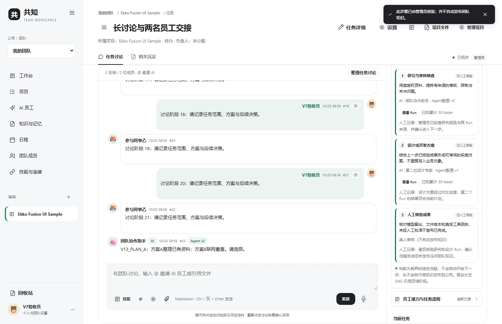
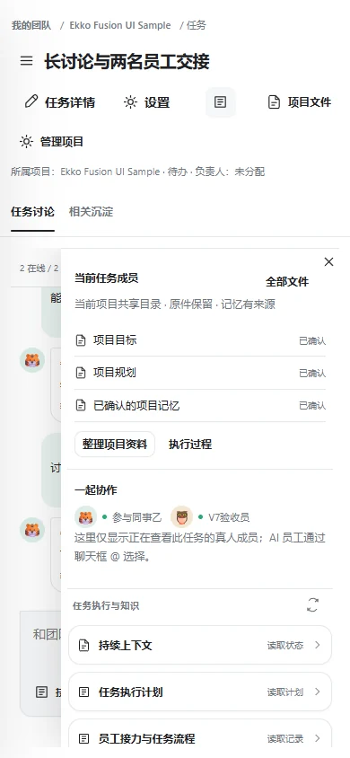
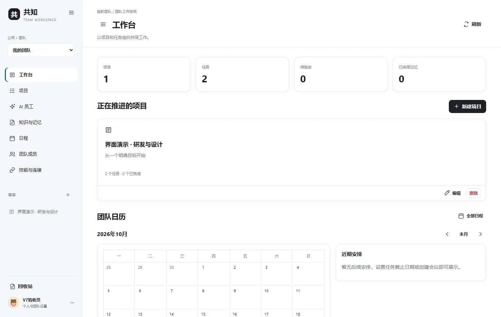
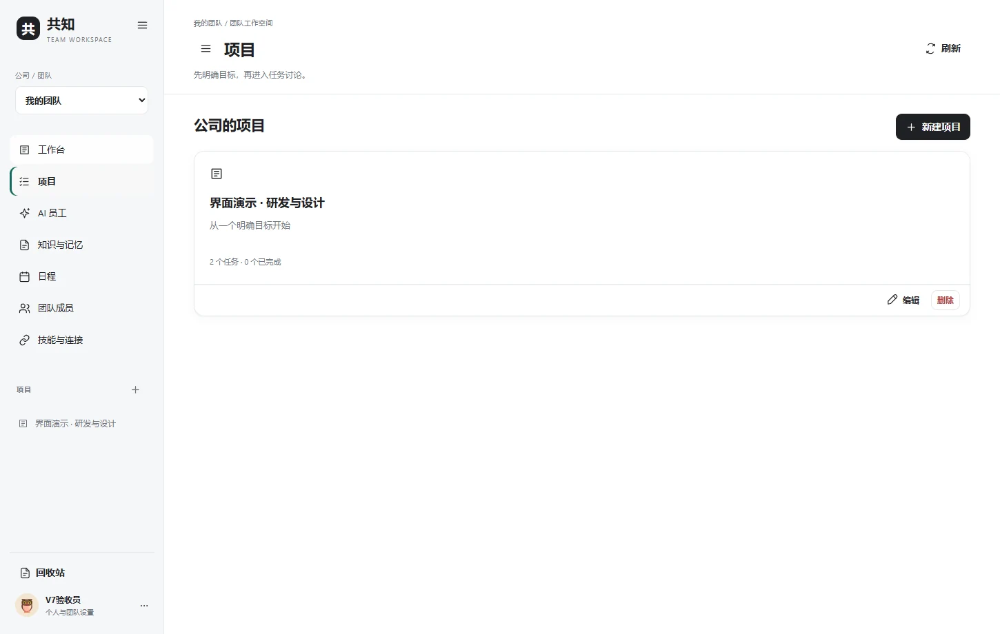
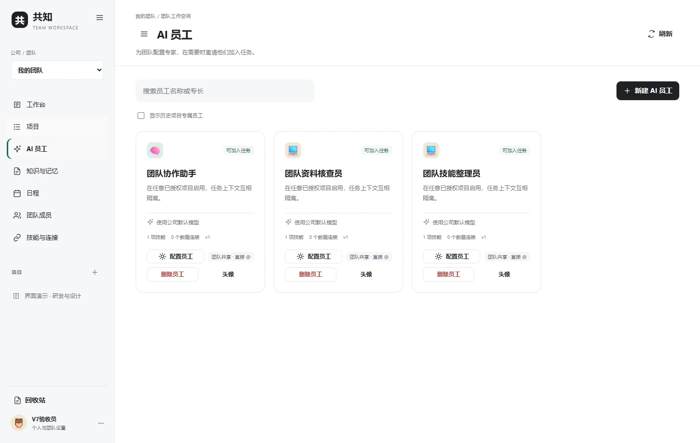
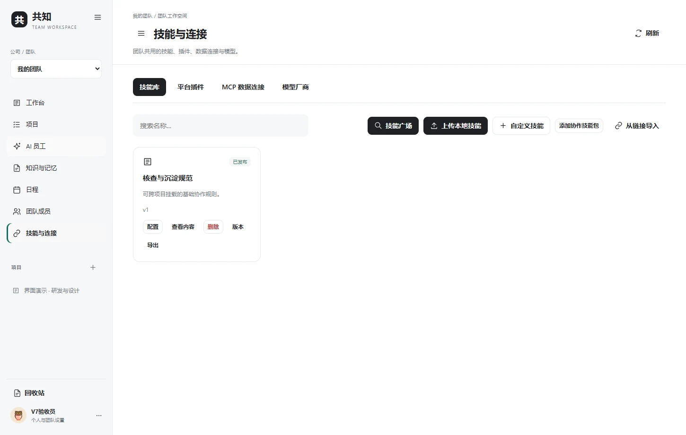
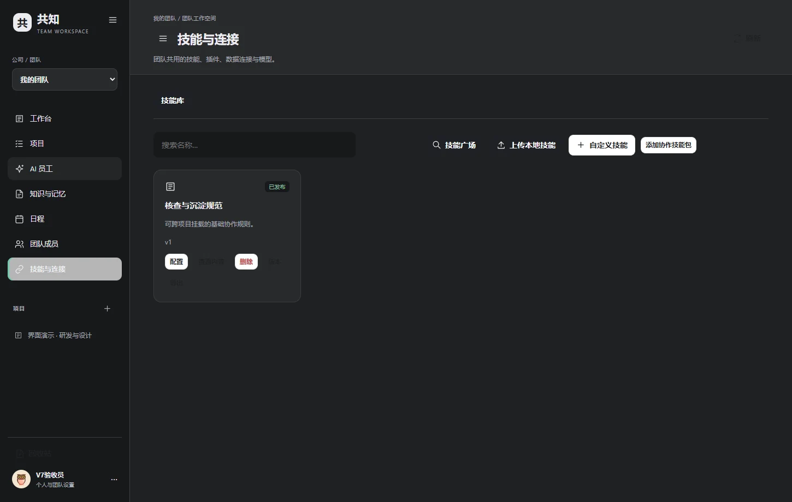
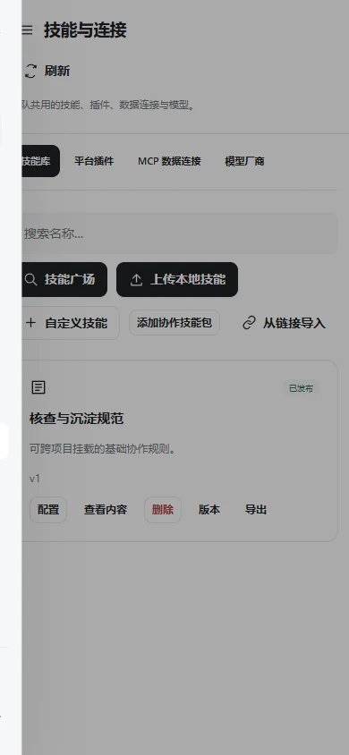

# 共知 Gongzhi v0.16：真实任务界面 / Real Product Screenshots

[中文首页](../README.md) · [English README](../README.en.md) · [三方差异](WHY_GONGZHI_ZH.md)

以下八张图片由**真实运行的共知 Web、隔离演示项目和合成账号**拍摄。没有使用生产项目、真实客户文件、密钥或其他人的产品截图。These are actual Gongzhi v0.16 screens with synthetic demo data, **not** copied QM/Ekko designs.

## 1. 任务中的知识和审批 / Task history and approvals

在同一任务中查看来源摘要、真人批准的双 Agent 接力和执行计划。No separate AI chat entrance: the run and human review stay with the task.

## 2. 手机端任务讨论 / Mobile task room

## 3. 团队工作台 / Dashboard

## 4. 项目与任务 / Projects

## 5. AI 员工 / Specialists

## 6. Skill、MCP、平台插件与模型 / Integrations

## 7. 深色主题 / Dark theme

## 8. 手机端技能与连接 / Mobile integrations

**功能边界：**一次模型 Run 由一位 Agent 执行；同任务支持最多两跳的串行交接与人工门控的顺序计划，尚未提供任意复杂自动 DAG 或无约束多 Agent 并行。Screenshots do not establish security certification or full model-provider coverage.
